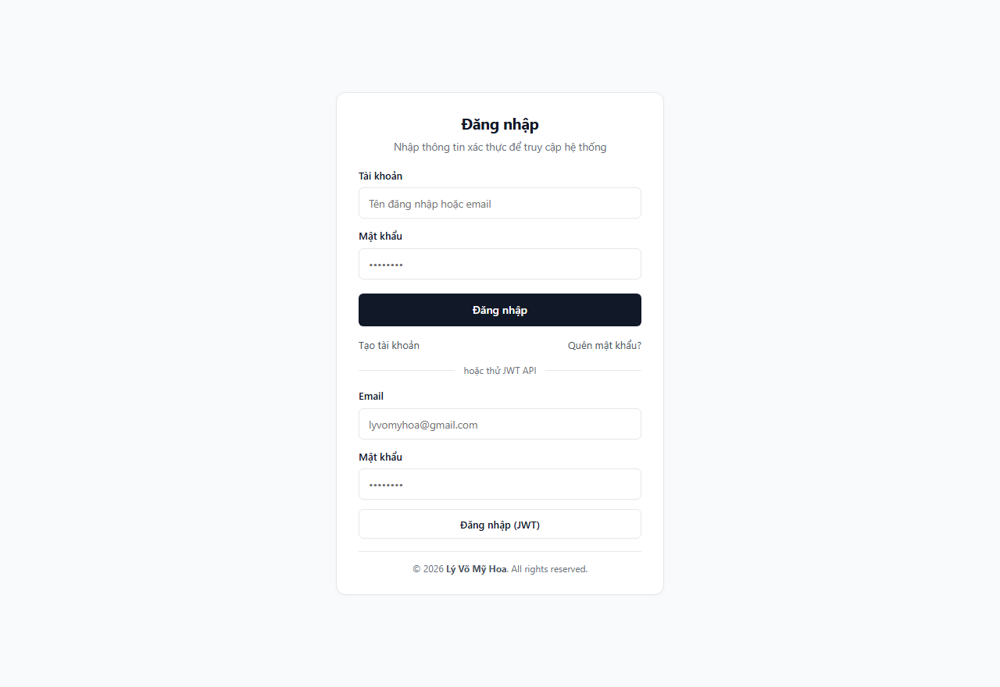
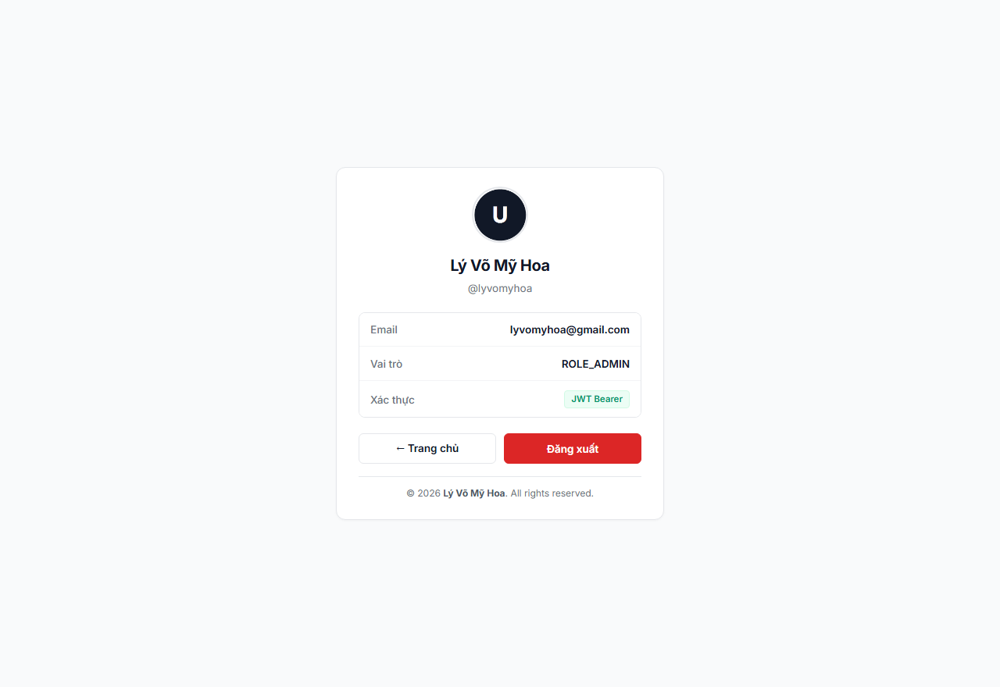
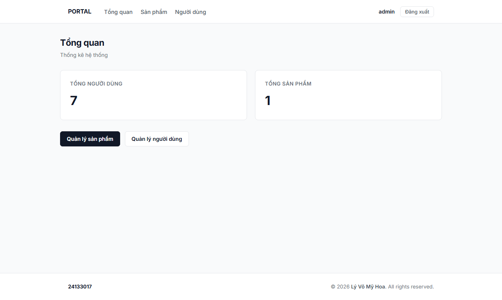
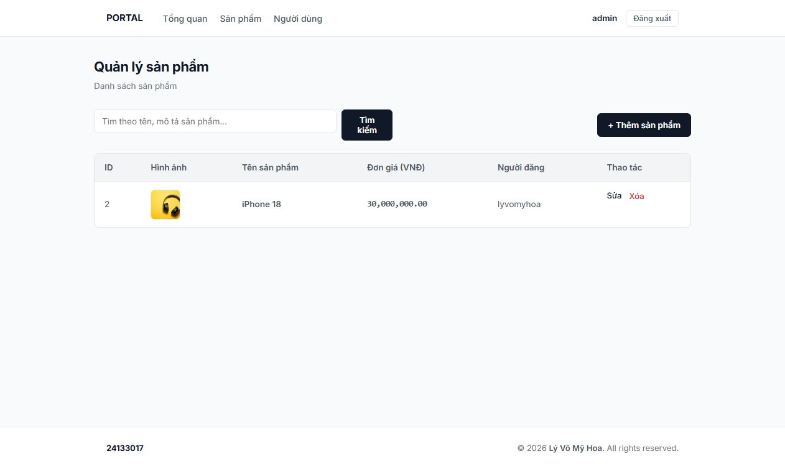
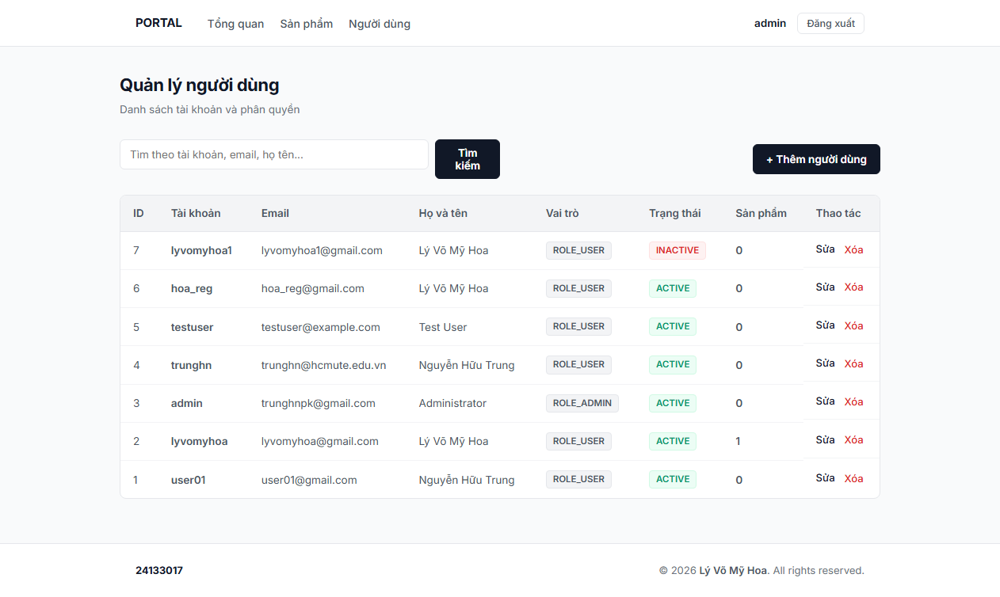
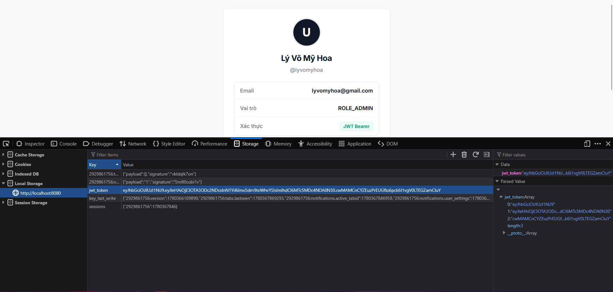

# Web Assignment 10

> Student: Lý Võ Mỹ Hoa - 24133017

## Overview

Triển khai **JSON Web Token (JWT)** trên Spring Boot 4 – Security 7, sử dụng thư viện **Nimbus JOSE+JWT**.

## URLs

### Giao diện

- Trang chủ: [http://localhost:8080/](http://localhost:8080/)
- Đăng nhập: [http://localhost:8080/login](http://localhost:8080/login)
- Hồ sơ người dùng: [http://localhost:8080/user/profile](http://localhost:8080/user/profile)
- Quản lý sản phẩm: [http://localhost:8080/products](http://localhost:8080/products)
- Quản lý người dùng: [http://localhost:8080/users](http://localhost:8080/users)

## Screenshots

### Login (Giao diện đăng nhập hỗ trợ Form & JWT API)

### Profile (Hồ sơ người dùng xác thực qua JWT Bearer)

### Dashboard

### Product Management

### User Management

### Local Storage

